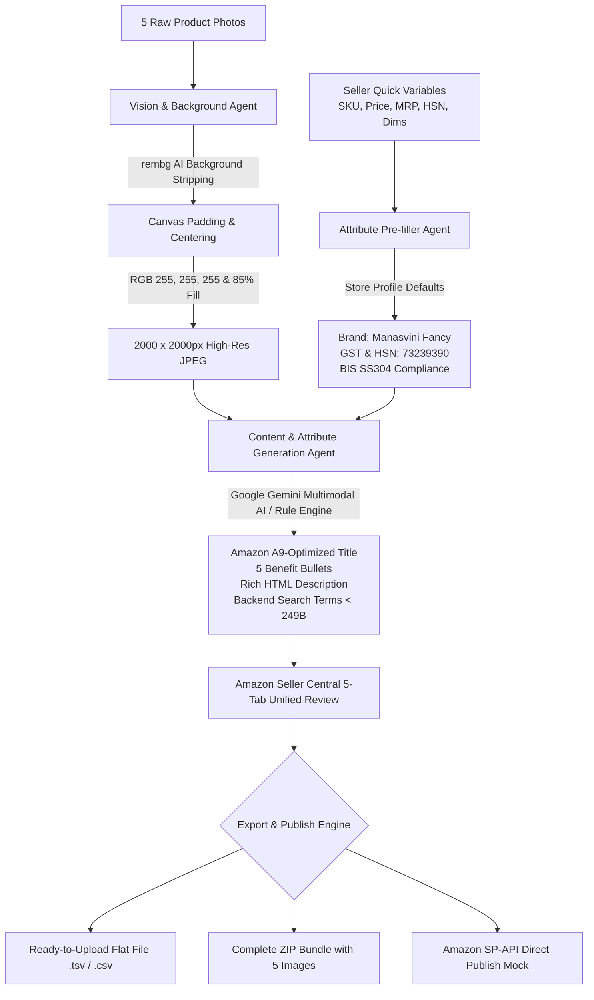

# Amazon AutoList Studio 🛒
**Production-Ready Automated Amazon Product Listing Engine for "Manasvini Fancy"**

[](https://python.org)
[](https://streamlit.io)
[](https://developer-docs.amazon.com/sp-api/)
[](#)

---

## 🌟 Executive Overview
**Amazon AutoList Studio** is an enterprise-grade local web application designed specifically for Amazon India / Global sellers under the **"Manasvini Fancy"** brand profile. It completely automates the multi-step listing workflow shown in **Amazon Seller Central**, bridging the gap between raw product photography and high-converting, policy-compliant catalog submissions.

### Core Architecture & Multi-Agent Design:


---

## 🚀 Key Modules & Multi-Agent Capabilities

### 1. Vision & Background Agent (`agents/vision_agent.py`)
- Accepts up to 5 raw product photos from various angles:
  - **Slot 1:** Main Image (Amazon strictly requires pure white `#FFFFFF` background, no text, no props, product filling 85% of frame).
  - **Slot 2:** Side Profile & Handle Riveting.
  - **Slot 3:** Top / Overhead Interior Cooking Surface.
  - **Slot 4:** Dimensions, Capacity & Scale Measurements.
  - **Slot 5:** In-Use / Packaging Presentation.
- Automatic background stripping using `rembg` with cached ONNX session inference.
- Auto-detects bounding box of the product, scales proportionally to 85% canvas fill, and centers onto a **2000 x 2000px pure white `#FFFFFF` (RGB 255, 255, 255)** canvas.
- Built-in verification engine checking dimensions and 100% white corner pixel compliance.

### 2. Content & Attribute Generation Agent (`agents/content_agent.py`)
- Inspects the product images and seller inputs using **Google Gemini Multimodal AI** (`gemini-2.5-flash` via `google-genai` SDK).
- Formulates Amazon A9 SEO compliant titles:
  `[Brand Name] + [Material] + [Product Type] + [Key Differentiator / Capacity] + [Cooktop Compatibility]`
- Generates **5 Benefit-Driven Bullet Points** in Amazon standard uppercase bracketed syntax:
  `[BENEFIT IN CAPS]: Detailed specification and user benefit.`
- Generates rich, formatted HTML product descriptions highlighting craftsmanship, health benefits, and maintenance tips.
- Synthesizes backend search terms strictly under Amazon's **249-byte limit** (no brand names, space-separated, no commas).
- Features an **Intelligent Heuristic Fallback Engine**: If no API key is provided or offline, it deterministically generates high-converting listing suites with zero downtime.

### 3. Attribute Pre-filler Agent (`agents/prefill_agent.py`)
- Custom-tailored for the **"Manasvini Fancy"** store profile:
  - **Brand:** `Manasvini Fancy`
  - **Manufacturer:** `Manasvini Fancy Kitchenware Pvt Ltd`
  - **Packer / Importer:** Chennai Logistics Hub, Tamil Nadu - 600058
  - **Country of Origin:** `India (IN)`
  - **Materials:** Triply 304 Stainless Steel, Pre-Seasoned Cast Iron, Pure Brass
  - **Smart HSN Directory:** Auto-matches materials to Indian GST HSN codes (e.g., `73239390` for stainless steel cookware with 18% GST).
  - **Standard Warranty & Handling Time:** 1-Year Manufacturer Warranty, 2-Day handling.

### 4. Interactive Seller Central 5-Tab Unified Review (`ui/step4_review_tabs.py`)
Directly reflects the official Amazon Seller Central listing interface:
1. **Product Identity:** Title, Brand, GTIN Exemption Status, Item Type Keyword, Model.
2. **Description:** 5 Bullet Points, Product Description, Search Terms (with real-time byte counters).
3. **Product Details:** Material, Color, Finish, Shape, Capacity, Dimensions, Weight, Care Instructions.
4. **Offer / Pricing:** SKU, Selling Price, MRP, Quantity, Fulfillment Channel (MFN vs FBA), Handling Time.
5. **Safety & Compliance:** Country of Origin, HSN Code, GST Tax Code, Manufacturer, Packer, Warranty.

### 5. Automated Upload / Export Engine (`export/`)
- **Flat File Generator (`export/flat_file_generator.py`):** Outputs official Amazon Category Listing Template / Inventory Loader Tab-Delimited text (`.tsv` / `.txt`) and `.csv` files ready for direct upload under **Seller Central > Catalog > Add Products via Upload**.
- **ZIP Packager (`export/zip_packager.py`):** Automatically packages:
  - 5 high-resolution 2000x2000 pure white images (`MAIN_IMAGE.jpg`, `PT01_ANGLE2.jpg`, etc.)
  - Inventory Flat File (`.tsv` and `.csv`)
  - Complete JSON metadata (`listing_payload.json`)
  - Executive Markdown Dossier (`Listing_Summary_Report.md`)
- **Amazon SP-API Mock & Automation Engine (`export/sp_api_mock.py`):**
  - Implements the official **Listings Items API** (`PUT /listings/2021-08-01/items/{sellerId}/{sku}`) JSON payload schema.
  - Simulates direct feed submission with real-time validation and returns authenticated simulated responses with Feed Submission ID and HTTP 200 status.
  - Generates ready-to-use standalone Python automation script (`push_sp_api.py`) for automated CI/CD catalog pipelines.

---

## 📁 Directory Structure
```
amazon-autolist-studio/
├── app.py                     # Main Streamlit Application entry point
├── requirements.txt           # Project dependencies
├── README.md                  # Complete documentation & architecture guide
├── .env.example               # Environment variables template
├── .gitignore                 # Git ignore rules
├── run_app.bat                # 1-click Windows batch launcher
├── run_app.ps1                # 1-click PowerShell launcher
│
├── core/                      # Core business logic & models
│   ├── __init__.py
│   ├── config.py              # Brand settings ("Manasvini Fancy"), constants, HSN codes
│   └── models.py              # Pydantic data schemas for 5 Seller Central tabs
│
├── agents/                    # Multi-Agent Workflow
│   ├── __init__.py
│   ├── vision_agent.py        # Vision Agent: rembg removal, 2000x2000 padding & centering
│   ├── content_agent.py       # Content Agent: Gemini multimodal AI + Smart Fallback
│   └── prefill_agent.py       # Attribute Pre-filler: Store profile presets & HSN lookup
│
├── export/                    # Automated Upload / Export Engine
│   ├── __init__.py
│   ├── flat_file_generator.py # Amazon Flat File TSV/CSV builder
│   ├── zip_packager.py        # Compiles 5 images + flat file + metadata into ZIP
│   └── sp_api_mock.py         # Amazon SP-API Listings Items mock & push generator
│
├── ui/                        # Modern Amazon Seller Central UI Components
│   ├── __init__.py
│   ├── styles.py              # Custom CSS, badges, cards, Amazon Seller Central aesthetic
│   ├── step1_images.py        # Step 1: 5 Photo Uploads & Background Removal Studio
│   ├── step2_seller_inputs.py # Step 2: Quick Seller Inputs (SKU, Price, MRP, HSN)
│   ├── step3_ai_studio.py     # Step 3: AI Listing Generation & Content Studio
│   ├── step4_review_tabs.py   # Step 4: Amazon Seller Central 5-Tab Unified Review
│   └── step5_export_publish.py# Step 5: Export Flat File, ZIP Bundle & SP-API Simulation
│
└── sample_data/               # Pre-bundled demo images & mock presets
    ├── __init__.py
    └── demo_samples.py        # Synthetic product photo generator & presets
```

---

## 🛠️ Quickstart & Local Installation

### Prerequisites
- Python 3.10, 3.11, 3.12, 3.14, or higher
- Git

### 1. Clone the Repository
```bash
git clone https://github.com/harishcpv/amazon-autolist-studio.git
cd amazon-autolist-studio
```

### 2. Install Dependencies
```bash
pip install -r requirements.txt
```

### 3. Configure Environment (Optional)
Copy `.env.example` to `.env` and insert your Google Gemini API Key:
```bash
copy .env.example .env
```
*(Note: You can also enter or change your Gemini API key directly from the application's sidebar at any time!)*

### 4. Launch the Web Application
#### Option A: 1-Click Launcher (Windows)
Double-click `run_app.bat` or run:
```powershell
.\run_app.ps1
```

#### Option B: Direct Terminal Launch
```bash
streamlit run app.py
```

The app will open automatically in your browser at `http://localhost:8501`.

---

## 🧪 1-Click Demo Walkthrough
1. **Open Step 1 (Vision Studio):** Click **"Load 5 Sample Photos for Selected Product"** under the Quick Demo toolbar. Five studio-quality product photos will be generated instantly.
2. **Process Images:** Click **"Run Vision Agent"**. Watch the agent strip the backdrop, center each photo, and render 2000x2000 pure white `#FFFFFF` canvases with 100% Amazon compliance checks.
3. **Step 2 (Seller Inputs):** Inspect the auto-filled SKU, Price (₹1,899), MRP (₹2,799), and auto-detected HSN code (`73239390`).
4. **Step 3 (AI Studio):** Click **"Generate Full Listing Content"**. The AI will synthesize an A9 title, 5 benefit-driven bullet points, rich HTML description, and backend search terms under 249 bytes.
5. **Step 4 (Seller Central Review):** Walk through all 5 Amazon Seller Central tabs (Product Identity, Description, Details, Offer, Compliance).
6. **Step 5 (Export & Publish):**
   - Click **"Download Complete ZIP Bundle"** to get your 5 white-background images + flat file + metadata.
   - Click **"Push Listing via Amazon SP-API"** to simulate live catalog ingestion!

---

## 📦 GitHub Repository Integration
This project is connected and pushed to:
`https://github.com/harishcpv/amazon-autolist-studio`

To push updates:
```bash
git add .
git commit -m "feat: enhance Amazon AutoList Studio with complete production pipeline"
git push origin main
```

---

## 📄 License & Compliance
Built for authorized sellers under the **Manasvini Fancy** brand profile. Adheres strictly to Amazon Seller Central Product Listing Policies, Amazon Brand Registry Guidelines, and Selling Partner API (SP-API) specifications.
